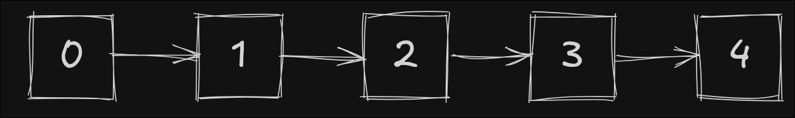
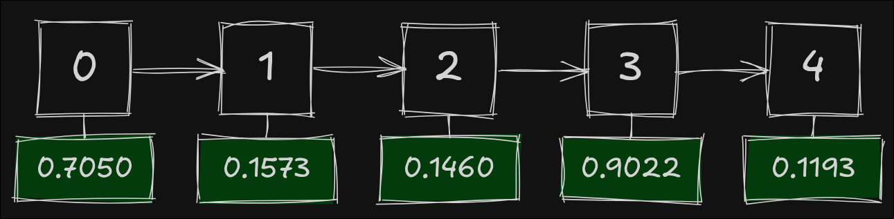
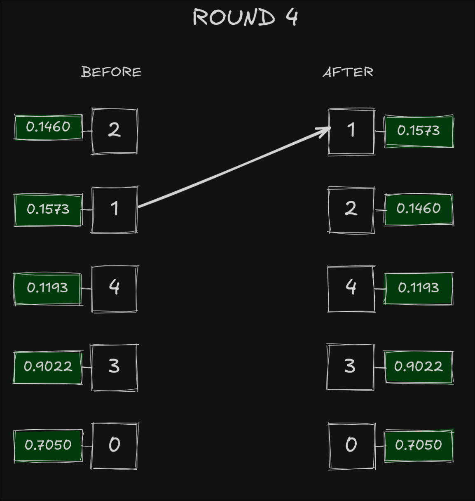

+++
title = "I Banned Random Numbers from My Game. It Turned Out Beautiful."
date = "2025-03-29T11:30:55+01:00"
author = "DarkBones"
cover = ""
tags = []
keywords = ["game development", "procedural generation", "deterministic systems", "math", "python", "randomness", "indie dev", "game design"]
description = "How I built a deterministic system to simulate randomness in my game. No random numbers allowed. From hashing usernames to procedural social media chaos."
showFullContent = false
readingTime = true
hideComments = true
draft = true
+++

# I Banned Random Numbers from My Game. It Turned Out Beautiful.

In most games, randomness just needs to *feel* right. Players don’t care if it’s truly random. They care about variety, surprise, and consistency. Turns out, you can fake all three without calling `random()` once.

For the past week and a half, I've been working on a small Android game. It revolves around a satirical social media app the player uses to get into politics, and eventually take over the world. While designing it, I gave myself one unbreakable rule:

> No random numbers. Everything must be deterministic.

Same input? Same output. Every time. Slightly different input? Entirely different outcome.

This lets me simulate randomness without ever having to store state. The game world *emerges* from player input alone.

## The Reason? I'm Lazy

Why would I impose such a restriction on myself? Because **not** doing it would actually be *more* work.

For example: NPCs in the game show up as user profiles on the fake social media site. Each one has a "random" profile color and a personality, how susceptible they are to praise, attacks, or bribes.

I don’t want to generate those traits and store them somewhere. That means saving data, loading it later, handling broken saves, migrations, schema versions... Ugh. No thanks.

Instead, I just take an NPC’s username and *derive* everything from it. No need to store or sync anything. Same username = same behavior. Forever.

### The Bonus Benefit

It also makes the experience **weirdly shareable**.

Bob: Did you have SirPoopsALot in your mentions? They're so hard to bribe!
Alice: I know, right? I had to attack them until they died by lack of popularity!

But enough talk, let's dive into some code.

## 1. Turning Strings Into Floats

The core principle is that I can take a string that is always the same (the username of an NPC) and get a floating point value out of it. 

Here’s the full implementation of string_to_float() in Python, based on FNV-1a hashing:

```
# utils/hashing/string_to_float.py
def string_to_float(s: str, min_value: float, max_value: float) -> float:
    string_hash = _fnv1a_32(s)
    hash_seed = string_hash & 0xFFFF
    return _map_to_range(hash_seed, 0, 0xFFFF, min_value, max_value)


def _fnv1a_32(s: str) -> int:
    h = 2166136261
    prime = 16777619
    for char in s:
        h ^= ord(char)
        h = (h * prime) & 0xFFFFFFFF
    return h


def _map_to_range(
    value: int, in_min: int, in_max: int, out_min: float, out_max: float
) -> float:
    t = float(value - in_min) / float(in_max - in_min)
    return out_min + (t * (out_max - out_min))


if __name__ == "__main__":
    test_cases = [
        "SirPoopsALot",
        "coolguy_420",
        "xXx_69_wizard_xXx",
        "the_real_Felon",
        "egirl_karen",
        "npc_001",
        "definitely_not_a_bot",
    ]

    print("Username".ljust(24), "|", "Deterministic Float")
    print("-" * 24 + "-+-" + "-" * 21)

    for tc in test_cases:
        val = string_to_float(tc, 0, 1)
        print(tc.ljust(24), "|", f"{val:.6f}")
```

The Output:

```
| Username             | Deterministic Float |
|----------------------|---------------------|
| SirPoopsALot         | 0.233860            |
| coolguy_420          | 0.736553            |
| xXx_69_wizard_xXx    | 0.484901            |
| the_real_Felon       | 0.530159            |
| egirl_karen          | 0.436530            |
| npc_001              | 0.000916            |
| definitely_not_a_bot | 0.887251            |
```

The **Plain English** of the code above: We want to take a string like `"SirPoopsALot"` and turn it into a number between 0 and 1. Always the same number, every time.

## How and Why It Works

Let's step through the code and peek under the hood.

### string_to_float

1. `string_hash = _fnv1a_32(s)`

This line takes the input string `"SirPoopsALot"` and turns it into a **32-bit integer** using a custom hash function. That `_fnv1a_32` function is a version of **FNV-1a**, a lightweight, fast, non-cryptographic hash algorithm (so, don't use it for your password vault).

It's great for this use-case because:

- It's **deterministic** - same input always gives the same output.
- It's **chaotic** - tiny changes in input lead to massive changes in output.
- It's **fast and portable** - works anywhere, no dependencies.

**Examples:**

```
_fnv1a_32("SirPoopsALot") -> 3960814558
_fnv1a_32("SirPOopsALot") -> 820050878
```

2. `hash_seed = string_hash & 0xFFFF`

This trims the **32-bit** hash down to a **16-bit** number by masking the upper half. In binary:

```
11101100000101010011101111011110
                ^^^^^^^^^^^^^^^^ [keep this part]
```

So we're left with:
```
0011101111011110 = 15326 (decimal)
```

> Why not write a `_fnv1a_16` instead?

Short answer: **Starting with 32 bits gives better distribution.** Hashing more bits and slicing is better than hashing fewer bits directly.

### _fnv1a_32

1. `h = 2166136261`

This is the FNV offset basis. It’s a magic number. It looks weird. Leave it alone.

- It's a **32-bit prime**.
- Being prime helps avoid patterns and collisions.
- It's used in most *FNV-1a* implementations for 32-bit hashing.

> Side note: If you've ever tried to design a flag with 51 stars, you already know why primes avoid patterns.

2. `prime = 16777619`

Another prime constant. This one is the **FNV prime multiplier**, used to mix up the bits during hashing.

3. `for char in s:`

Iterates over each character in the string. If this is the part that confuses you, leave a comment. I would love to hear your story.

4. `h ^= ord(char)`

`ord(char)` gives the *Unicode code point* of the character (a.k.a. turns it into a number). Then we **XOR** it into our hash.

- XOR (`^`) is used to combine each character into a growing hash state.
- This adds entropy without needing a lookup table or extra memory.

5. `h = (h * prime) & 0xFFFFFFFF`

After each XOR, we multiply the result by our magic prime. This step spreads the bits and makes the hash values less predictable.

- `0xFFFFFFFF` keeps the value in the **32-bit range**

6. `return h`

Boom. Now we got ourselves a nice, chaotic 32-bit hash of `"SirPoopsALot"`.

Next step? We map it into a float using simple linear mapping. The math is straightforward, so I won't cover it here, but it's just scaling the 16-bit `hash_seed` into our target range.

## Turning Floats Into Game Elements

Now that we have the power to take any string and convert it to the same float each time, let's see how we can wield that power.

### Floats to Colors

The avatar of an NPC is just a colored circle with their initial in it. So I wrote a little more code:

```
import colorsys

SATURATION_MIN = 0.4
SATURATION_MAX = 1.0
VALUE_MIN = 0.4
VALUE_MAX = 0.8

def string_to_color(s: str) -> tuple[float, float, float]:
    string_hash = _fnv1a_32(s)

    # Extract RGB components from hash (just like in GDScript)
    r = (string_hash & 0xFF) % 256
    g = ((string_hash >> 8) & 0xFF) % 256
    b = ((string_hash >> 16) & 0xFF) % 256

    # Normalize to [0, 1] for HSV conversion
    r_norm, g_norm, b_norm = r / 255.0, g / 255.0, b / 255.0

    # Convert to HSV
    h, s, v = colorsys.rgb_to_hsv(r_norm, g_norm, b_norm)

    # Clamp saturation and value
    s = _proportional_clamp(s, SATURATION_MIN, SATURATION_MAX)
    v = _proportional_clamp(v, VALUE_MIN, VALUE_MAX)

    # Convert back to RGB
    r_final, g_final, b_final = colorsys.hsv_to_rgb(h, s, v)
    return (r_final, g_final, b_final)


def _proportional_clamp(value: float, min_val: float, max_val: float) -> float:
    return ((max_val - min_val) * value) + min_val
```

The output becomes:

```
| Username             | Deterministic Float | Color (RGB Hex) |
|----------------------|---------------------|-----------------|
| SirPoopsALot         | 0.233860            | #BE2C0A         |
| coolguy_420          | 0.736553            | #7FB11D         |
| xXx_69_wizard_xXx    | 0.484901            | #189747         |
| the_real_Felon       | 0.530159            | #AF5449         |
| egirl_karen          | 0.436530            | #B24439         |
| npc_001              | 0.000916            | #4B0095         |
| definitely_not_a_bot | 0.887251            | #11C070         |
```

I won't go over this line-by-line like the hashing algorithm. But here are some of the important things and techniques to note:

* **We extract RGB values from the hash itself.**
By slicing different parts of the 32-bit hash, we get deterministic red, green, and blue components. No RNG needed.

* **We convert RGB to HSV to control how the color looks.**
HSV (Hue, Saturation, Value) is way easier to work with when you want consistent brightness and colorfulness. Raw RGB can sometimes give you washed-out or ultra-bright colors.

* **We clamp the Saturation and Value to a pleasant range.**
That's what `SATURATION_MIN`, `SATURATION_MAX`, etc. are for. But instead of cutting them off at some threshhold, I decided to remap the values proportionally, as not to waste any of our beautiful entropy.

* **Then we convert back to RGB**
Once we've made the HSV adjustments, we convert the results back to RGB for whatever rendering system we're using.

> **The result: visually consistent, unique colors for each username.**

### The Easiest Gotcha To Solve

Using the NPC's username to generate its stats is clever. But here's the catch with deterministic floats: they're always the same.

Sounds obvious, but it can bite you in unexpected ways.

To illustrate, let's say you're building an RPG with stats like `INT`, `DEX`, and `STR`.

> If you use the exact same input string for every stat, you’ll get the same value for every stat.

No worries.

```
self.int = string_to_float(self.name + "_intelligence", 0, 1)
self.dex = string_to_float(self.name + "_dexterity", 0, 1)
self.str = string_to_float(self.name + "_strength", 0, 1)
```

> Just salt the string differently for each stat. Easy fix, easy win.

Want them to add up to something sensible (like `1.0`)? No problem, just normalize or scale as needed.

## Doing the Fisher-Yates Shuffle

This next part is what made me stop coding and start writing. It's so clean, so chaotic, and so beautifully deterministic that I had to share it.

In my game, players interact with a fake social media site. NPCs are constantly posting all sorts of nonsense in a timeline. I wrote a *long* list of prewritten posts for NPCs to share.

> I don’t want them seeing the same post twice until they’ve cycled through *all* of them.

That means I need to pick a random-looking post from the list, without repeats, all while keeping things deterministic. No saving which ones have been posted. No RNG. But still random-feeling.

Most devs would reach for `random.shuffle()`, but in my game, calls to `random` are **banned**. That means implementing a different kind of shuffle. One that's chaotic, but reproducible.

Let's build it.

## 1. A Boring Ordered List

We'll start here: With a boringly sorted list.



Nothing special. Just five integers in order. Not very random, not very fun.

> What if we take these numbers and use them as a seed for a hash?

## 2. Username To Chaos

So far, we've used the username of an NPC to generate its stats. But in my game, the **player** also has a username. That gives us a beautiful opportunity:

> We can use the player's username as a **seed** for random-feeling, deterministic behavior.

Let's say I'm playing the game. And my username is `'DarkBones'`, same as on this platform.

Now, let's assign a "random" float to every number in our boring list. Here's how I generate the seed for each item:

```
seed = f"DarkBones_{i * 16777619}_x_seeded_random"
```

### Wait, what's with all the extra stuff?

That long, weird-looking seed is doing a few important things:

- `DarkBones` - This is the player's username. It ensures that the result is unique per player.
- `i * 16777619` - Instead of just using `i`, we multiply it by a big prime number, the same as the FNV-1a algorithm, to reduce patterns and increase entropy.
- `_x_seeded_random` - This is just static noise. It makes the input string longer and less predictable, creating more entropy.

Using `f"DarkBones_{i}"` also would have worked, but the resulting floats were not "random" enough for my liking.



## 3. Shuffle Without Random

At this point, you might think *"Okay, let's just assign each item a random number and sort the list by it."*

That would work, but it's **not** what I'm doing here.

Instead, I implemented a version of the **Fisher-Yates shuffle**, a classic algorithm (predating computers) for shuffling lists in-place. The twist is that I'm using my `string_to_float()` function to make it **deterministic**.

## Line-by-Line: Fisher-Yates

```
p = list(range(n))
```

We start with a boring ordered list: `[0, 1, 2, 3, 4]`.

```
for i in range(n - 1, 0, -1):
```

Fisher-Yates works *backward*. For each position `i`, we'll pick a position `j <= i` and swap `i` with `j`.

```
    step_seed = f"{perm_seed}_{i * 16777619}_x_seeded_random"
```

This generates a unique string seed for this step in the shuffle. A few design notes:

* `perm_seed` is the player's username (or any unique identifier).
* `i * 16777619` ensures the seed is different per step, and the prime multiplier helps scramble the bits.
* The rest is just noisy padding to increase entropy.

```
    j_float = string_to_float(step_seed, 0.0, float(i + 1))
    j = int(j_float)
    j = max(0, min(j, i))  # clamp
```

We use the seed to generate a float in `[0, i+1]`, convert it into an integer, and clamp it to make sure it's valid.

This gives us a deterministic "random" index `j` to swap with `i`.

```
    p[i], p[j] = p[j], p[i]
```

All that's left to do is swap the two indexes, and we have completed one cycle of the loop. We do this for all values of `i` and we end up with a **fully shuffled permutation**, no repeats, no randomness, and totally determined by the seed.

### Putting it all together

Here's the complete Fisher-Yates permutation generator for python:

```
def generate_permutation(perm_seed: str, n: int, string_to_float) -> list[int]:
    assert n > 0, "n must be positive"

    # Start with a sorted list
    p = list(range(n))

    # Fisher-Yates shuffle, seeded deterministically
    for i in range(n - 1, 0, -1):
        step_seed = f"{perm_seed}_{i * 16777619}_x_seeded_random"

        j_float = string_to_float(step_seed, 0.0, float(i + 1))
        j = int(j_float)
        j = max(0, min(j, i))  # clamp j between 0 and i

        # Swap elements at positions i and j
        p[i], p[j] = p[j], p[i]

    return p
```




## Why This Is Better Than Sorting By a Hash

Sorting items by a "random" float is fine when you're okay with static shuffles. But if you want a **real shuffle** (on that *feels* random and obeys the statistical properties of a uniform distribution), **Fisher-Yates is better**.

Why? Because sorting by float isn't really shuffling, it's *ranking*. You assign each item a number and arrange them in order. But that introduces subtle biases. Some permutations become more likely than others, especially if:

* Your float values aren't perfectly distributed
* The resolution of your floats is too low (collisions!)
* Or the hash space itself has quirks

Fisher-Yates doesn't have that problem.

It builds the permutation step by step, choosing where each element goes with a uniform (in our case, deterministic) choice from the valid range. It doesn't just look random, it *is* random. Each of the `n!` permutations has an equal chance of appearing.

In our version, we replace the "random" part with a float generated from a seed, so every shuffle is still perfectly repeatable, but without sacrificing fairness.

> Sorting by floats is easy.
> Fisher-Yates is correct.

It's chaos. But it's *your* chaos.

## TL;DR

You don’t need randomness to create surprising, delightful, or chaotic-feeling outcomes. Deterministic systems can be beautiful, expressive, and easier to manage. If it feels random to the player, it *is*.

Ultimately, banning `random()` forced me to think differently about generating variety and surprise. This deterministic approach, using hashing and a seeded shuffle, gives me exactly the kind of controlled chaos I need – predictable for debugging, unique for players, and requiring zero saved state for things like post timelines or NPC traits. It's a reminder that sometimes, the most powerful solutions are the ones you build yourself when the standard library doesn't quite fit the rules you've set.
